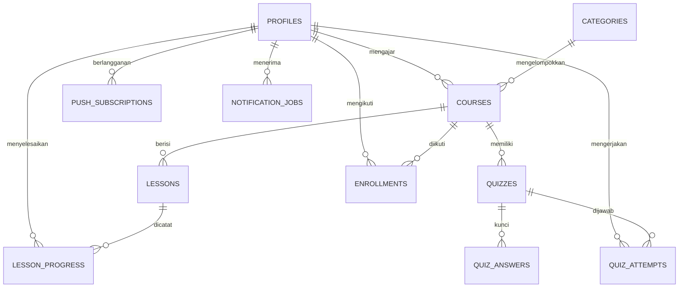

# Skema data

`profiles.id` berasal dari Supabase Auth UUID. `courses.instructor_id` menunjuk pengajar. `enrollments` memiliki unique (`student_id`, `course_id`); `lesson_progress` unique per peserta dan materi. Pertanyaan/pilihan kuis tersimpan di `quizzes.questions` JSONB, sedangkan jawaban benar berada di tabel `quiz_answers` yang tidak memiliki kebijakan baca bagi client. `quiz_attempts` menyimpan jawaban yang dikirim dan nilai 0–100. `push_subscriptions` menyimpan endpoint/key browser milik profil. `notification_jobs` menjadi payload pekerjaan yang diproses worker melalui BullMQ/Redis.

Constraint relasional, unique, dan check untuk harga/nilai/indeks jawaban didefinisikan pada `supabase/migrations/000_schema.sql` dan dicerminkan dalam Prisma schema.
